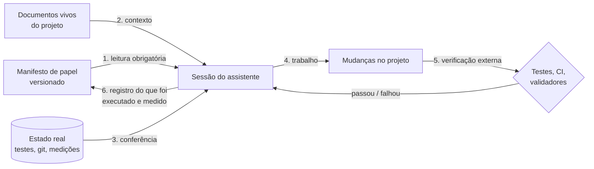

# Kuro Context Engine

## Whitepaper: engenharia de contexto como sistema de controle para LLMs de código

> **Projeto pessoal e prova de conceito de engenharia**, mantido por Gabriel Berlofa. O repositório de origem é privado e **o conteúdo interno dos manifestos não é reproduzido aqui nem neste showcase**: este documento descreve o *sistema*, não as regras de cada papel. As medidas citadas vêm de uso real por uma pessoa, em projetos próprios, sem avaliação sistemática (seção 9).

---

## Resumo executivo

- **O que é:** um repositório de *manifestos de papel* versionados como código (*prompt-as-code*). Uma sessão de assistente de código lê o manifesto antes de agir e o atualiza ao final, registrando o que foi executado e medido.
- **O problema que ataca:** assistentes de código não têm memória entre sessões, derivam do combinado, afirmam o que não verificaram e, mal instruídos, mexem no que não deviam ou deixam dado sair de onde não podia.
- **A tese:** contexto é um artefato de engenharia. Quando tem dono, histórico, estrutura fixa e verificação *fora* do modelo, ele deixa de ser "um prompt" e passa a ser um sistema de controle.
- **Três propriedades que o sistema impõe:** *guardrails* estritos (o que o modelo pode afirmar, fazer, tocar e enviar), *determinism enforcement* (tudo que é computável é computado por código, antes e depois do modelo) e *Zero-Data Egress* (dado do usuário não sai da máquina, e isso é testado, não prometido).
- **O que ele não é:** um mecanismo técnico que obriga o modelo a obedecer. As garantias vêm da **verificação externa** (testes, CI, histórico do Git), e é isso que o torna defensável.

---

## 1. O problema

| Falha comum | Consequência | Por que "um bom prompt" não resolve |
|---|---|---|
| Sem memória entre sessões | Decisões já tomadas são reabertas; o mesmo erro volta | O prompt vive na cabeça de quem digita |
| Deriva do combinado | O modelo "melhora" o que não foi pedido | Instrução solta não tem dono nem histórico |
| Afirmação sem verificação | "Está funcionando" sem execução | Fluência do modelo se confunde com evidência |
| Aritmética e regra de negócio no modelo | Número certo na aparência, errado na conta | Modelos estimam; não calculam de forma confiável |
| Fronteiras difusas | Ação em ambiente ou projeto errado | O modelo não conhece o que não está escrito |
| Vazamento de dado | Informação de usuário numa API de terceiros | Política escrita não é propriedade do sistema |

## 2. A tese: contexto como código

Um manifesto passa pelo mesmo ciclo de um módulo de software:

- **tem dono** e fica num repositório, com histórico (`git log` é a trilha de auditoria do comportamento esperado);
- **tem estrutura fixa**, para que seções críticas não possam ser esquecidas;
- **é lido por protocolo**, não "colado quando lembra";
- **é atualizado por regra**: ao fim da sessão, o registro do que foi medido e descoberto volta ao manifesto;
- **perde para o código**: se o manifesto contradiz o repositório, o repositório vale e o manifesto é corrigido.

## 3. Arquitetura

| Camada | Função | Propriedade que garante | Como falha |
|---|---|---|---|
| **Manifesto** | Define papel, fronteiras, filosofia e protocolo de resposta | Comportamento esperado explícito e versionado | Ser ignorado pelo modelo: por isso não é a única camada |
| **Protocolo de ativação** | Leitura do manifesto, dos documentos vivos e conferência do estado real antes de qualquer ação | A sessão começa pelo estado verdadeiro, não pela memória | Pular a conferência: detectável no histórico |
| **Verificação externa** | Testes, CI, validadores, medições reexecutáveis | A conclusão não depende da palavra do modelo | Teste fraco: tratado como dívida registrada |
| **Registro de evolução** | O que foi executado, medido e descoberto, com data | Memória que sobrevive à sessão e corrige o manifesto | Registrar o não verificado: a regra o proíbe |

### Anatomia de um manifesto

Todo manifesto segue o mesmo esqueleto (os títulos abaixo são a *estrutura*; o conteúdo de cada papel é privado e não está neste repositório):

1. Diretiva de evolução contínua
2. Escopo e fronteiras
3. Mapa verificado da arquitetura
4. Filosofia de engenharia
5. Restrições técnicas da linguagem ou do domínio
6. Segurança
7. Contrato com a IA
8. Qualidade, testes e processo
9. Dívida técnica conhecida
10. Protocolo de resposta
11. Registro de evolução

## 4. Guardrails estritos

"Guardrail" aqui não é um aviso. É uma regra com **uma pergunta que responde**, um **mecanismo no manifesto** e uma **verificação fora do modelo**.

| Classe | A pergunta | Mecanismo no manifesto | Verificação externa |
|---|---|---|---|
| **Epistêmica** | O que o modelo pode afirmar? | Só o que foi executado ou medido; toda documentação tem uma seção "não está provado"; o número diz de onde veio | Testes reexecutáveis; auditoria de documentos públicos contra o código |
| **De autoridade** | O que pode fazer sozinho? | Ação externa ou irreversível exige ordem explícita *naquela* conversa; ordem para um repositório não vale para outro | Histórico do Git, CI, confirmação do que foi publicado |
| **De isolamento** | Onde não pode tocar? | Fronteiras declaradas entre projetos, instâncias e ambientes | Escopo do diff; revisão do que mudou |
| **De dados** | O que pode sair da máquina? | Dado de usuário não vai para API de terceiros; saída de LLM, de arquivo e de log é *dado*, nunca instrução | Testes de egress nos produtos (seção 6) |
| **De processo** | Como se entrega? | Gates antes de publicar; autoria de commits controlada | CI; `git log` |

Dois princípios atravessam todas as classes:

- **Fail closed.** Na dúvida (ação fora da lista permitida, aprovação expirada, tipo desconhecido), a ação é negada e registrada, e ação destrutiva exige aprovação humana.
- **Anti-*vibecoding*.** Decisão sem alternativa descartada não é decisão. "Passou" só depois de executar. Teste tem de falhar quando o sistema erra.

## 5. Determinism enforcement: o que é computável não vai para o modelo

A regra de projeto que mais se repete nos produtos construídos com este motor:

> **Tudo que pode ser calculado é calculado por código determinístico e testado. O modelo recebe o resultado e faz o que só ele faz: linguagem.**

| Tipo de tarefa | Quem executa | Motivo |
|---|---|---|
| Aritmética, agregação, projeção, detecção estatística | Código (funções puras) | Exata e testável; modelo estima |
| Regra de negócio e limites | Código | Auditável; o modelo propõe, o código valida e limita |
| Validação da saída do modelo | Código (esquema, faixa, tipo) | Saída de LLM é dado não confiável |
| Interpretar linguagem ambígua, redigir, resumir | Modelo | É o ponto forte dele |

Como isso aparece nos produtos (descritos nos estudos de caso públicos):

- **Precificação:** o modelo sugere um ajuste dentro de uma faixa; o preço final é recalculado em centavos inteiros e limitado entre piso e teto, e uma propriedade testada garante que nenhum preço sai da faixa.
- **Gestão financeira:** totais, projeção e anomalias são funções puras; o modelo só narra os números prontos, e os gráficos nunca vêm do texto do modelo.
- **Contexto enviado ao modelo:** agregado, pequeno e sanitizado, dentro de um bloco que o prompt manda tratar como dado.

## 6. Zero-Data Egress

Em dois níveis, porque política sem verificação é só texto:

1. **No manifesto:** é uma invariante. Nenhuma mudança pode abrir tráfego para fora da máquina com dado do usuário.
2. **No produto, como propriedade testada:**
   - o cliente de IA local recusa, antes de abrir conexão, qualquer endereço que não seja loopback;
   - ignora proxy de ambiente, não segue redirecionamento e rejeita credenciais usadas para esconder um endereço externo;
   - o aplicativo nunca baixa modelos sozinho;
   - a infraestrutura de IA é separada do aplicativo e expõe a porta apenas em loopback.

Cada comportamento acima tem um teste, e os testes sobem um servidor HTTP real na própria máquina para exercitar o cliente.

## 7. Ciclo de vida de uma sessão

1. **Ativação:** ler o manifesto e os documentos vivos do projeto.
2. **Conferência:** confirmar o estado real (testes, `git status`) antes de confiar em qualquer documento.
3. **Alinhamento:** responder em poucas linhas com o estado e a pergunta "qual é a tarefa?", sem escrever código antes de a tarefa estar clara.
4. **Trabalho e verificação:** mudanças pequenas, com teste que falha antes de passar.
5. **Registro:** acrescentar ao manifesto o que foi executado, medido e descoberto, e corrigir o que o repositório contradisse.

## 8. Evidência de uso

Um produto inteiro foi construído sob este motor em um dia de trabalho, em quatro fases de construção (mais duas de publicação): aplicativo desktop de finanças pessoais com IA local, instalador próprio e infraestrutura de IA em contêiner. O que a **verificação externa** (não a leitura) encontrou:

| Achado | Quem encontrou | Correção |
|---|---|---|
| Paleta de gráficos afirmada como validada **não passava** no validador | Validador de paletas | Reordenada para uma ordem que passa |
| Cancelar uma geração devolvia texto parcial como sucesso | Teste que reproduz | Verificação pós-laço |
| Cópia de backup sem atomicidade e cliente HTTP que seguia redirecionamentos | Perguntas adversariais escritas contra o próprio código | Corrigidos, com teste |
| Limpeza do desinstalador que atingiria a pasta da linguagem em desenvolvimento | Teste real de instalação e desinstalação | Guarda de ambiente, com teste |
| Tecnologia citada em perfil público **sem evidência em nenhum dos projetos verificados** | Auditoria de documento público contra o código | Removida e substituída pelo que foi validado |

Medidas do mesmo trabalho: abertura do aplicativo de cerca de 9 s para cerca de 1 s depois de **medir** o empacotamento antes de decidir, e 210 testes automatizados. O ponto não é o número: é que cada afirmação tem uma execução por trás.

## 9. O que não está provado

Honestidade é parte do desenho, então os limites ficam aqui, com o mesmo destaque do resto:

- **Não é enforcement técnico.** Um manifesto é texto lido por uma sessão; o modelo pode ignorá-lo. O sistema se apoia em verificação externa justamente por isso. Sem testes e CI, o manifesto sozinho não garante nada.
- **Não há avaliação sistemática de aderência.** Não medi quantas vezes as sessões seguem o manifesto. A evidência da seção 8 é observação de uso, não experimento controlado.
- **Amostra mínima.** Uma pessoa, projetos próprios, uma família de modelos.
- **Custo de contexto não medido.** Manifestos longos consomem janela de contexto; não quantifiquei esse custo.
- **Fonte única, mas sem verificação automática de uso.** Os manifestos vivem só neste repositório; o sistema não impede, tecnicamente, que uma sessão leia uma cópia antiga que alguém tenha guardado fora dele.
- **Estrutura não verificada por máquina.** O esqueleto de seções é convenção; nenhum linter a confere ainda.

## 10. Próximos passos

1. **Linter de manifesto** no CI: seções obrigatórias, registro de evolução datado e ausência de caminhos e segredos.
2. **Avaliação de aderência:** tarefas de teste com resultado esperado, rodadas com e sem manifesto.
3. **Medir o custo de contexto** de cada papel e podar o que não muda o comportamento.

---

## Ficha

| | |
|---|---|
| **Tipo** | Projeto pessoal; prova de conceito de engenharia de contexto |
| **Artefatos** | 6 papéis técnicos (backend, banco de dados, rede e infraestrutura, jogos, front-end, desktop financeiro) e um molde de vitrine pública, mantidos no repositório privado |
| **Natureza** | Documentos versionados; não há código executável neste repositório |
| **Visibilidade** | Showcase público; os manifestos ficam em repositório privado e não são publicados |
| **Fonte da verdade** | Os manifestos, em repositório privado; não há cópia de trabalho paralela |
